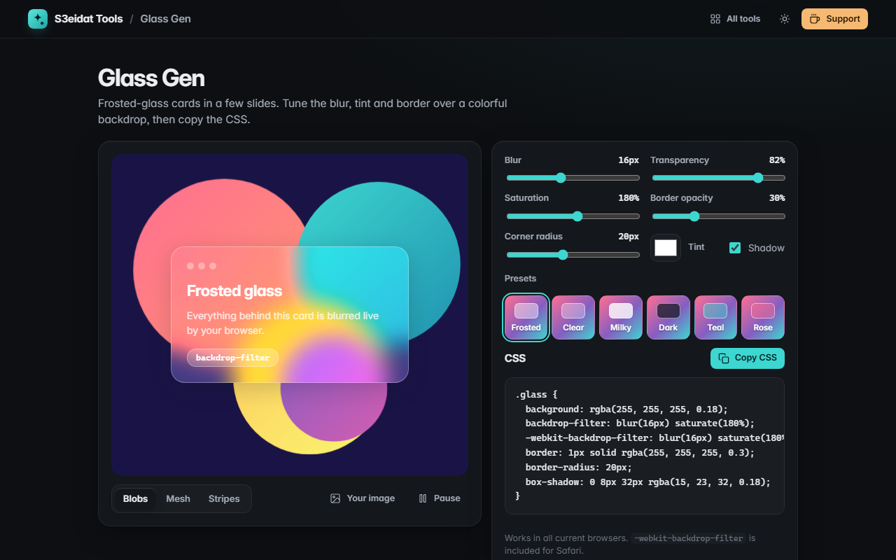

# Glass Gen

> Glassmorphism (frosted glass) CSS generator with a live preview. Free, private, and it runs entirely in your browser.

### ▶ [Open Glass Gen](https://s3eidat.github.io/glass-gen/)



## Features

- Sliders for **blur, transparency, saturation, border opacity and corner radius**, plus a **tint color** and optional shadow
- Live preview using the real `backdrop-filter` over a **colorful animated backdrop** (blobs, mesh or stripes), with a pause button
- Try it over **your own image**: it's shown locally and never uploaded
- **6 presets**: frosted, clear, milky, dark, teal and rose
- **Copy CSS** including `-webkit-backdrop-filter` for Safari
- Text color on the sample card switches automatically for light, opaque tints

## Privacy

Nothing you make, and no image you pick, leaves your device. There is no server, no account, no analytics.
The page ships with a strict Content-Security-Policy (`connect-src 'self'`), so the browser
itself blocks any attempt to send data anywhere.

## Run it yourself

It's plain HTML, CSS and JavaScript with no build step:

```bash
git clone https://github.com/s3eidat/glass-gen
cd glass-gen
python -m http.server 8000
```

Then open http://localhost:8000.

## Support

If this saved you time, **[buy me a coffee ☕](https://s3eidat.github.io/coffee/)**. It keeps every tool free.

---

Part of **[S3eidat Tools](https://s3eidat.github.io/)**: 100+ free, private tools that run in your browser. MIT licensed.
